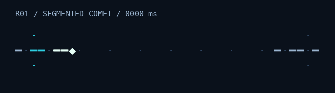

# Spark

**Small terminal art. Your app keeps the controls.**

A Rust / Ratatui animated-art experiment with explicit-time sampling, a borrowed
widget view, and permission-limited cell writes. This is the **F01–F06 foundation
vertical slice**, not the full six-design v0.1 release. The only implemented design
is R01, Segmented Comet.



*Generated from the same Rust cells used by consumers. Fixed DejaVu Sans Mono
preview, not a claim about every terminal/font.*

## Run it

```sh
cargo run -p spark-gallery
cargo run -p spark-catalog --example sync_host
```

Rust **1.90.0**, `ratatui-core` **0.1.2**, and application `ratatui` **0.30.2** are
pinned and exercised together. The renderer owns no clock, terminal IO, threads,
network calls, or scheduler. It needs no AI service, special font, or async runtime.

## Embed it

Store a `SegmentedComet` in your host. Supply clip time on each draw:

```rust
use spark_catalog::SegmentedComet;
use spark_runtime::{ClipTime, Palette, Profile, SampleContext};

let comet = SegmentedComet::new().with_seed(7);
let palette = Palette::default();
let profile = Profile::default();
let context = SampleContext::new(
    ClipTime::from_nanos(400_000_000),
    &palette,
    &profile,
);
let sample = comet.sample(&context);
// frame.render_widget(sample, caller_owned_area);
// sample.frame_interval(caller_owned_area.size()) is advisory only.
```

The complete buffer version is a compiled rustdoc example. The standalone
[external consumer](fixtures/consumer/src/main.rs) also implements a different
widget through public runtime APIs, without a runtime modification.

A sample can be requested twice, backwards, or at a large timestamp without
advancing state. Keep rendering paused/static art on unrelated redraws. Render
base content freshly; give art an owned rectangle and explicit protected regions.
Wide host glyphs and special diff cells are conservatively preserved.

## What is here

- Four workspace packages: runtime, catalog, native gallery, and `xtask`
- Validated integer clip time/period, palette overrides, ASCII/Unicode,
  truecolor/ANSI-16/monochrome, full/reduced/static motion
- One adaptive segmented comet with a borrowed ordinary `Widget` view
- Clipping/protection/wide-character tests, exact styled-cell snapshots,
  shuffled-time tests, compiled host and downstream examples
- Actual loop/contact-sheet/embedding previews and an explicitly limited baseline
- Six design briefs, provenance policy, author template, and architecture decisions

Inline output, decorators, the other five designs, asset playback, general
playback/deadline helpers, async/paced hosts, and release qualification are deferred.


## Check and reproduce

```sh
cargo fmt --all -- --check
cargo clippy --workspace --all-targets --locked -- -D warnings
cargo test --workspace --all-targets --locked
cargo test --workspace --doc --locked
cargo xtask validate
cargo xtask snapshots --check
cargo run -p spark-gallery -- --smoke
cargo run -p spark-catalog --example sync_host -- --smoke
cargo run --manifest-path fixtures/consumer/Cargo.toml --locked
cargo xtask render segmented-comet
cargo xtask baseline
```

See [compatibility](docs/compatibility.md), [performance and capture methods](docs/performance.md),
[API review](docs/api-review.md), [integration](docs/integration.md),
[architecture and roadmap](docs/architecture.md), and [authoring](docs/authoring.md).

## Status and terms

Provisional local package names; packages are not published. No project license
has been selected or granted. Repository source commits are authorized; a package
release and distribution terms remain an owner decision. See [PROVENANCE](PROVENANCE.md).
