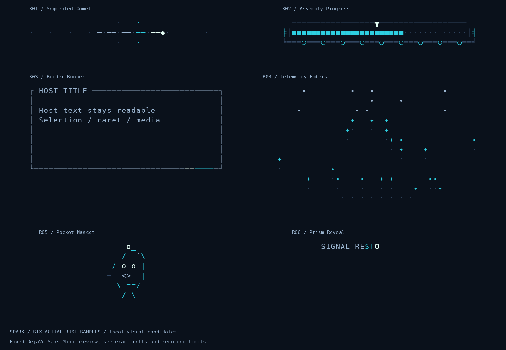

# Spark

**Small terminal art. Your app keeps the controls.**

Six distinctive Rust/Ratatui designs, sampled at explicit time and embedded through
ordinary widgets, inline text and permission-limited decorators. The host keeps its
event loop, state, data and terminal. No AI service, renderer-owned clock, IO, thread
or mandatory async runtime.

**Status: MIT-licensed foundation source candidate.** All six designs are implemented.
See [publication verification](docs/publication.md) for the current checks and
[foundation status](docs/foundation-status.md) for historical evidence and remaining
platform/release gates. The crates are not published to a registry.



Fixed DejaVu Sans Mono previews from real consumer cells, not promotional mockups
or a claim about every terminal/font.

## Try the gallery

Install Rust with rustup, then clone and run (the toolchain file pins Rust 1.90.0):

```sh
git clone https://github.com/Jagalite/spark.git
cd spark
cargo run -p spark-gallery
cargo run -p spark-gallery -- --smoke
```

Choose a design; pause/restart/scrub; change size, palette, capability profile,
speed, seed and input; inspect static or embedded views. Inactive designs do not
animate in the selector. Press `i` for the live Rust inspector and `e` to export
a compilable configuration. For terminal-free export and exact settings, see the
[playground guide](docs/playground.md). Run `--help` for current controls.

Rust **1.90.0**, `ratatui-core` **0.1.2** and application `ratatui` **0.30.2** are pinned.
See [compatibility](docs/compatibility.md) for tested and unqualified routes.

## Six compositions

- **Segmented Comet:** broken luminous trail, widget or exact-width styled `Line`
- **Assembly Progress:** conveyor/gantry controlled by truthful known/unknown progress
- **Border Runner:** restrained style-only perimeter highlight with explicit exclusions
- **Telemetry Embers:** seeded rising particles controlled by caller-supplied level
- **Pocket Mascot:** original authored ASCII creature with held, blink and squash poses
- **Prism Reveal:** finite text sweep, final readable pose and safe Unicode fallback

Profiles include ASCII/Unicode, truecolor/ANSI16/monochrome and full/reduced/static
motion. Wide host glyphs, selected cells, titles and reserved rectangles are protected.
No per-design crates, mandatory registry, font icons or image protocols.

## Embed one design

```rust
use spark_catalog::SegmentedComet;
use spark_runtime::{ClipTime, Palette, Profile, SampleContext};

let comet = SegmentedComet::new().with_seed(7); // Store once.
let palette = Palette::default();
let profile = Profile::default();
let context = SampleContext::new(
    ClipTime::from_nanos(400_000_000), &palette, &profile,
);
let sample = comet.sample(&context); // Borrowed, no hidden state advancement.
// frame.render_widget(sample, caller_owned_area);
// sample.change_hint(caller_owned_area.as_size()) is optional advice.
let status_line = sample.inline(24).expect("width at most 256");
```

The buffer form is compiled as a rustdoc test. Separate
[one-design](fixtures/consumer/src/main.rs) and
[all-six](fixtures/consumer-all/src/main.rs) consumers compile against public APIs.
The independent [CrossWeave holdout](fixtures/holdout/src/main.rs) authors a new
design with runtime-only dependencies and no runtime change.

## Composition and extensions

Finite sequences, delayed parallel tracks and integer transitions are available in
`spark_runtime::composition`. See [composition](docs/composition.md) and the
[expansion status](docs/expansions.md) for runnable examples and the remaining work.

## Host-owned integration

```sh
cargo run -p spark-catalog --example sync_host -- --smoke
cargo run -p spark-catalog --example async_host -- --smoke
cargo run -p spark-catalog --example paced_host -- --smoke
```

The synchronous, async event and already-paced examples render the same designs.
Optional playback maps caller-supplied host time to clip time; a pure planner merges
advice with the host's own cadence. Paused, hidden, static and finished visuals stop
requesting animation frames but still draw on unrelated redraws. Rendering never
completes business operations. See [integration](docs/integration.md).

## Verify and reproduce

```sh
cargo fmt --all -- --check
cargo clippy --workspace --all-targets --locked -- -D warnings
cargo test --workspace --all-targets --locked
cargo test --workspace --doc --locked
cargo xtask validate
cargo xtask snapshots --check
cargo xtask generate-assets --check
cargo xtask render pocket-mascot --fixture request-result
cargo xtask record pocket-mascot
cargo xtask qualify pocket-mascot
cargo xtask package-audit
cargo xtask baseline
```

The tools report missing checks rather than manufacture a passing release badge.
Git retains required regression goldens, six full GIFs, the overview and directly
linked review images. Bulk exact-cell captures, other generated derivatives, raw
recordings, detailed historical machine reports and logs are private archival or
reproducible outputs, as explained in
[ARTIFACTS](ARTIFACTS.md). [Performance](docs/performance.md) names measured stages and omissions.
[Authoring](docs/authoring.md) covers validated assets and review guardrails.

## Terms

Licensed under [MIT](LICENSE), with [third-party notices](NOTICE.md). Code and visual
provenance are tracked separately in [PROVENANCE](PROVENANCE.md). Public registry
names and package releases remain separate decisions; all packages retain
`publish = false`. CI validates source changes but does not deploy or publish packages.
